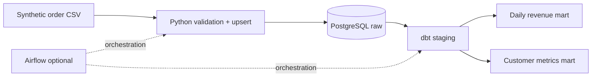

# E-commerce Data Platform — Data Engineering Portfolio

A reproducible **end-to-end ETL/ELT demonstration** with synthetic e-commerce orders, Python ingestion, PostgreSQL, dbt models/tests, optional Apache Airflow orchestration, Docker Compose and CI.

> **Portfolio disclosure:** This is an original demonstration, not a client engagement. All source data are synthetic. No sales uplift or production-scale performance is claimed.

## Architecture



## Quick start (Docker)

Requirements: Docker Engine with Compose plugin. Airflow is optional and needs additional RAM.

```bash
cp .env.example .env
# Start database
docker compose up -d postgres
# Build and run the entire reproducible pipeline
docker compose --profile run run --build --rm pipeline
```

Expected result: 1,000 deterministic orders upserted, data quality passes, dbt builds staging and marts with green tests. Re-running the pipeline does not duplicate `order_id` rows.

### Inspect results

```bash
docker compose exec postgres psql -U demo -d ecommerce -c 'SELECT * FROM analytics_marts.daily_revenue LIMIT 10;'
docker compose exec postgres psql -U demo -d ecommerce -c 'SELECT * FROM analytics_marts.customer_metrics LIMIT 10;'
```

Note: dbt-postgres with custom `+schema: marts` generates `analytics_marts` by default; staging is `analytics_staging`.

### Optional Airflow scheduler and UI

```bash
docker compose --profile orchestration up -d --build airflow
```

Visit http://localhost:8080; Airflow standalone writes an admin password to its container logs / standalone credentials file. On first startup allow time for initialization. Find the `ecommerce_etl_demo` DAG, unpause and trigger it. This is a **local demo**, not a production-hardened Airflow deployment (Airflow metadata uses the standalone defaults).

### Run only Python unit tests

```bash
pip install -r requirements.txt
python -m pytest -q
```

## Data model

- `raw.orders`: event-level synthetic orders; unique order ID, status, timestamp, category, quantity and price
- `analytics_staging.stg_orders`: cleaned typed view and calculated gross amount
- `analytics_marts.daily_revenue`: completed-order revenue per day/category
- `analytics_marts.customer_metrics`: completed orders, customer lifetime value and first/last order date

## Engineering practices demonstrated

- Deterministic fixture generation, no external API credentials or secrets
- Transactional upserts: repeated runs do not create duplicate order IDs
- Row-level validation: required fields, prices, status and timezones
- Separate raw, staging and mart layers
- dbt schema tests and custom SQL assertion
- Optional Airflow retries and DAG scheduling
- Automated unit tests on GitHub Actions

## Next steps for an actual client

Replace synthetic data with authorized API extracts, introduce incremental watermarks instead of full re-generation, implement secret management, alerting and production Airflow deployment, and optionally migrate analytics to BigQuery.

See [architecture](docs/architecture.md) and [Upwork portfolio summary](docs/PORTFOLIO.md).
