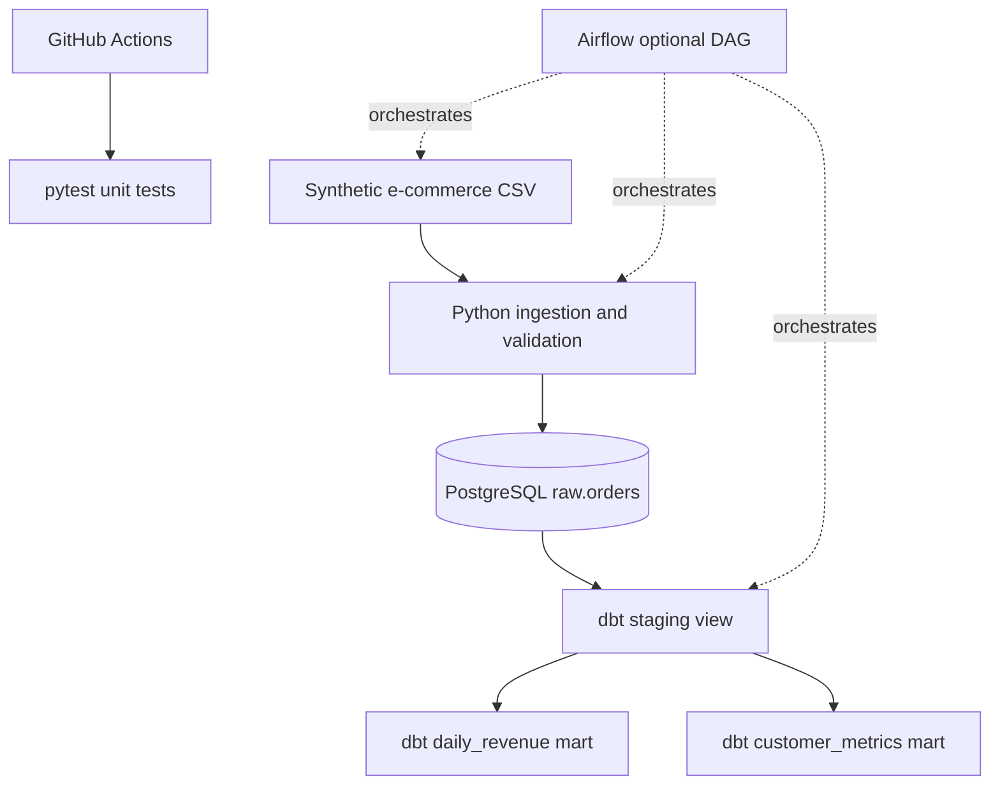

# Architecture

Raw is loaded with `ON CONFLICT` for rerun safety. dbt filters completed orders and tests unique/non-null keys. Airflow is an optional orchestration mode, not required for a successful local demo.
